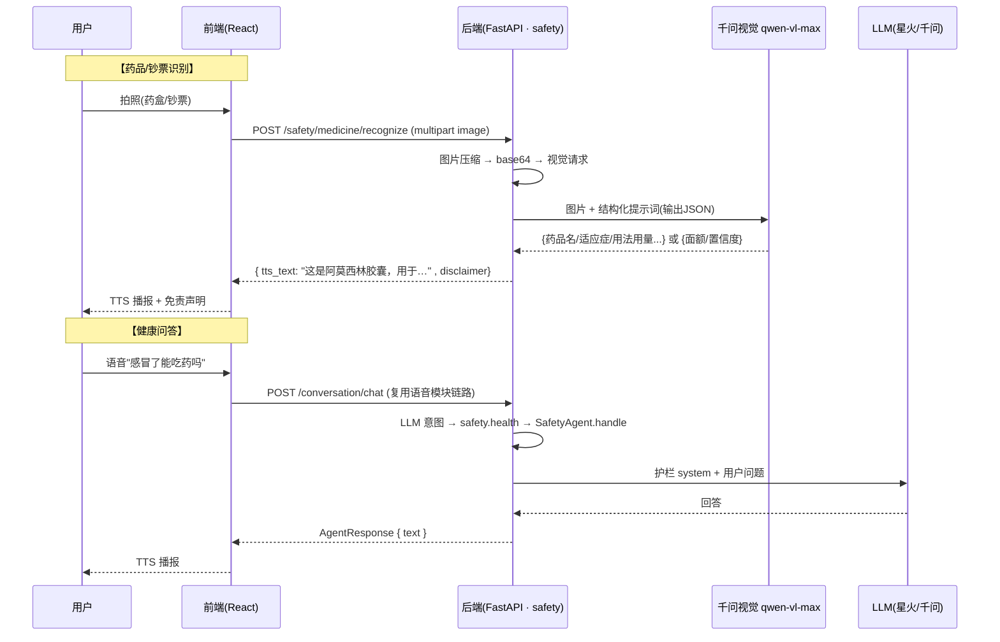

# 安全模块开发思路（人C）

> 版本: v1(草稿) ｜ 日期: 2026-08-11 ｜ 状态: 待评审
>
> 本文档描述安全模块本期三个能力的开发思路：**药品识别、健康问答、钞票识别**。
> 归属: Safety Agent（`agents/safety/`），由人C 负责。
> 范围严格限定: 只做这三个功能，不做 SOS/告警/家属通知（按 [backend_design_plan.md](backend_design_plan.md) 为后续阶段）。
> **分工说明**: 钞票识别在 backend_design_plan 原归属 Perception（OCR 域），本次按最新分工划入安全模块，文档按此执行。

---

## 0. 可行性判断（先验证，后设计）

以 `.env` 现有密钥实测（2026-08-11）：

| 检查项 | 实测结果 | 结论 |
|---|---|---|
| DashScope 鉴权（`/compatible-mode/v1/models`） | HTTP 200，模型列表完整 | ✅ key 有效 |
| 文本模型 `qwen3.7-flash`（健康问答/问答用） | 正常返回内容 | ✅ 可用 |
| 视觉模型 `qwen-vl-max`（药品/钞票识别用） | `AllocationQuota.FreeTierOnly` 免费额度耗尽 | ⚠️ 已开通但需充值/关闭"仅免费额度"模式 |
| 视觉模型备选 | `qwen3-vl-plus`、`qwen-vl-ocr`、`qwen3.5-ocr` 均在模型列表 | ✅ 可选 |
| 讯飞星火 LLM（语音模块已接入） | 34 测试通过（2026-08-10 记录） | ✅ 备选供应商 |

**结论：三个功能均可行，且都有现成凭据支撑** —— 文本问答零阻塞；视觉识别（药品/钞票）技术通路已通，唯一阻塞是**千问视觉模型免费额度耗尽**。

**⚠️ 待处理（人C）**：登录 [阿里云百炼控制台](https://bailian.console.aliyun.com) → 模型广场/费用管理：
1. 关闭「仅使用免费额度」模式，或为账户充值（视觉识别单次调用成本极低）；
2. 或先在代码里把视觉模型切到 `qwen3-vl-plus` 试试是否仍有免费额度（本设计做成可配置）。

---

## 1. 目标与范围

**功能需求**:
- **药品识别**: 用户对药盒/药瓶拍照 → 播报药品名、适应症、用法用量与注意事项；
- **健康问答**: 用户语音提问健康问题 → LLM 回答并播报（带安全护栏）；
- **钞票识别**: 用户对纸币拍照 → 播报面额（"这是 50 元"）。

**本期范围**:

| 做 | 不做（预留/明确排除） |
|---|---|
| 药品识别：拍照 → 视觉 LLM 输出结构化药品信息 + 播报 | SOS 求救/自动告警/家属通知（下期） |
| 健康问答：LLM + 安全护栏（不诊断/不替代医嘱/紧急建议就医） | 用药提醒（归 Perception·reminder，下期） |
| 钞票识别：单张人民币面额识别 + 置信度过滤 | 多张钞票点数、外币识别（下期） |
| 识别图片不留存（仅内存 base64 传给模型） | 药品数据库/知识库（LLM 直答即可） |

## 2. 现状盘点（已有资产，尽量复用）

| 位置 | 现状 | 复用点 |
|---|---|---|
| [backend/.env](backend/.env) | `DASHSCOPE_API_KEY` 有效；视觉模型额度见 §0 | 直接读取 |
| [backend/app/config.py](backend/app/config.py) | `DASHSCOPE_VISION_MODEL = qwen-vl-max` 已定义 | 视觉模型名走配置 |
| [backend/app/core/llm.py](backend/app/core/llm.py) | `complete()` 已实现（星火/千问双供应商），只收文本 | 健康问答直接用；视觉需新增图片消息封装 |
| [backend/app/agents/safety/](backend/app/agents/safety/) | `agent.py` 占位、`api.py` 骨架、`service/placeholder.py` | 在此目录实现 |
| [backend/app/agents/orchestrator.py](backend/app/agents/orchestrator.py) | `INTENT_ROUTING: health → safety` 已映射 | 新增 `medicine`/`currency` 意图项需人A 登记（见 §4.4） |
| [backend/app/core/agent_protocol.py](backend/app/core/agent_protocol.py) | 冻结契约 `AgentRequest`/`AgentResponse` | `handle()` 返回体用它 |
| [backend/app/utils/image.py](backend/app/utils/image.py) | 图片工具占位 | 压缩/校验/转 base64 |
| [backend/app/core/errors.py](backend/app/core/errors.py) | 错误码体系（40001/50020…） | 前端播报文案映射已复用 |
| [frontend/src/services/safetyService.ts](frontend/src/services/safetyService.ts) | 占位（现有 SOS/家属，本期不用） | 新增三个方法 |
| [frontend/src/pages/SafetyPage.tsx](frontend/src/pages/SafetyPage.tsx) | 页面骨架已有 | 接真实逻辑 |

## 3. 总体架构与数据流



三个能力共用一条后端管线：**图片/文本 → 本模块 service → 外部模型 → 播报文案 → AgentResponse**。与语音模块的衔接方式和导航模块一致（工具注册表 + `handle()`）。

## 4. 关键设计决策

### 4.1 视觉识别统一走千问 VL（复用现有 DashScope 凭据）

- 药品、钞票识别共用 `service/vision.py`：图片压缩（≤10MB，转 JPEG 降尺寸）→ base64 → 千问 `content` 多模态消息；
- 模型名取 `settings.DASHSCOPE_VISION_MODEL`（qwen-vl-max），额度异常时可切 `qwen3-vl-plus`；
- 图片**只在内存**中转 base64 传给模型，**不落盘、不留存、不写日志**（药盒/钞票照片含隐私）。

### 4.2 结构化输出 + 容错解析

- 视觉请求的 system 提示词要求"只输出 JSON"（字段见 §6），复用语音模块 `chat.py` 的 `_extract_json()` 容错解析（星火无 `response_format`，千问兼容接口有，双通道都做容错）；
- 解析失败/关键字段缺失 → 播报"识别失败，请换个角度重新拍摄"，**宁可说不确定，不可说错**（AgentError 兜底原则）。

### 4.3 安全护栏（药品/健康是医疗场景，必须设防）

| 护栏 | 实现 |
|---|---|
| 免责声明必播 | 药品识别回复尾部固定追加："以上为 AI 识别结果，仅供参考，请以说明书和医嘱为准" |
| 不诊断不推荐 | 健康问答 system 提示词明令：不给出诊断、不推荐处方药、症状紧急（胸痛/呼吸困难/大出血等）→ 立即建议拨打 120 |
| 紧急关键词拦截 | 健康问答前置规则匹配（"120/急救/自杀/大出血"等），命中直接转急救指引，不走普通回答 |
| 置信度过滤（钞票） | 视觉模型返回置信度 < 0.7 → 播报"无法确认面额，请他人协助"，避免播错金额 |

### 4.4 与语音模块工具链的衔接

- `TOOL_REGISTRY` 现有 `safety.sos`（本期不做）。本期新增三个工具名由**人A 登记**：`safety.medicine`、`safety.health`、`safety.currency`，handler 指向本模块 `handle()`；
- `INTENT_ROUTING` 需人A 补两行：`"medicine": "safety"`、`"currency": "safety"`（`health` 已有）；
- 本模块 `handle()` 支持 intent：`health` / `medicine` / `currency`，图片场景参数为 `{image_base64}`（由工具 handler 转交）。

## 5. 后端实现方案

### 5.1 新增/改动文件清单

```
backend/app/agents/safety/
├── api.py                      # 改: 挂 POST /safety/medicine/recognize、/safety/health/ask、/safety/currency/recognize
├── schemas.py                  # 改: MedicineOut/HealthAsk/CurrencyOut
├── agent.py                    # 改: handle() 按 intent 分发三个能力
└── service/
    ├── vision.py               # 新: 图片压缩→base64→千问VL多模态请求(共享)
    ├── medicine.py             # 新: 药品识别(提示词+字段校验+免责声明)
    ├── health.py               # 新: 健康问答(护栏system+紧急词拦截)
    └── currency.py             # 新: 钞票识别(面额+置信度阈值)
```

### 5.2 视觉封装（`service/vision.py`）

```python
async def recognize_image(image_bytes: bytes, system: str) -> dict:
    """压缩→base64→qwen-vl 多模态请求→解析JSON。所有图片识别共用。"""
    # 1. utils/image.py: 校验格式(jpg/png) + 压缩(≤2MB, 长边≤2048px)
    # 2. llm 层新增 image_url 支持(或本模块直接 httpx 调 DashScope 兼容接口):
    #    messages: [{role:user, content:[{type:image_url, image_url:{url: data:image/jpeg;base64,...}},
    #                                    {type:text, text: system}]}]
    # 3. response_format json_object + _extract_json 容错
    # 4. 图片只存内存, 用完即弃
```

> 实现方式说明：`core/llm.py` 的 `complete()` 目前只支持文本消息。二选一：
> ①在 `core/llm.py` 加 `image` 参数（改共享核心，需人A 集成评审）；
> ②在 `service/vision.py` 内直接 httpx 调 DashScope 兼容接口（不动共享核心，推荐，依赖 `DASHSCOPE_API_KEY`）。
> 本设计采用 **②**，避免冻结区改动。

### 5.3 三个能力的提示词与输出

**药品识别**（`medicine.py`）—— system 提示词要点：你是药品信息解读助手，识别药盒/药瓶上的**药品名称、生产厂家、规格、适应症、用法用量、注意事项**；只输出 JSON；信息不确定的字段写 `"unknown"`，禁止编造。输出后组装播报：只播"名称 + 适应症 + 用法用量"三段，其余留 `data`；尾附免责声明。

**健康问答**（`health.py`）—— system：你是健康咨询助手，面向视障用户，回答简洁口语化（50 字内优先），不诊断、不推荐处方药，紧急情况建议就医/拨打 120。前置拦截：正则命中 `120|急救|自杀|大出血|胸痛|呼吸困难` → 直接返回急救指引播报。上下文最多携带最近 1 轮（不建知识库）。

**钞票识别**（`currency.py`）—— system：你是人民币面额识别器，识别图中纸币面额（1/5/10/20/50/100 元），只输出 `{"denomination": "50元", "confidence": 0.92}`，不确定时 `denomination` 给 `"unknown"`。置信度 < 0.7 或 unknown → 播报"无法确认面额，请他人协助"。

### 5.4 `handle()` 与 API

```python
async def handle(self, req: AgentRequest) -> AgentResponse:
    if req.intent == "health":
        text = await health.ask(req.params["question"])
        return AgentResponse(text=text, action=None, data=None)
    if req.intent in ("medicine", "currency"):
        img = base64.b64decode(req.params["image_base64"])
        # → medicine/currency 服务 → AgentResponse(text=播报文案, data=结构化结果)
    return AgentResponse(text="安全助手功能开发中", ...)  # 兜底
```

图片上传走 REST 端点（multipart），语音工具调用走 `handle()`（base64 透传），两路都复用同一 service。

## 6. API 接口定义

```http
### 1) 药品识别
POST /api/v1/safety/medicine/recognize    # multipart, 字段 image (jpg/png ≤10MB)
→ 200 { code: 200, data: {
      medicine: { name: "阿莫西林胶囊", category: "青霉素类抗生素",
                  indications: "用于敏感菌所致的呼吸道感染等",
                  dosage: "口服，一次0.5g，每6~8小时1次",
                  precautions: "青霉素过敏者禁用", unknown_fields: [] },
      tts_text: "识别到阿莫西林胶囊，用于…。以上为AI识别结果，仅供参考，请以说明书和医嘱为准"
    }, request_id }

### 2) 健康问答
POST /api/v1/safety/health/ask    # { question: "感冒了能吃药吗" }
→ 200 { code: 200, data: { answer: "建议多休息…", tts_text: "…" }, request_id }

### 3) 钞票识别
POST /api/v1/safety/currency/recognize    # multipart, 字段 image
→ 200 { code: 200, data: {
      currency: "CNY", amount: 50, denomination: "50元", confidence: 0.92,
      tts_text: "这是一张50元"
    }, request_id }
    # 低置信度: tts_text = "无法确认面额，请他人协助", denomination="unknown"
```

错误码沿用 [errors.py](backend/app/core/errors.py) 体系：
- `40001` 无图片/格式错 → "请拍摄药盒或钞票的照片"；
- `40200` 识别不出内容 → "识别失败，请换个角度重新拍摄"；
- `40300` 紧急词拦截 → 返回急救指引（不是报错）；
- `50020` 视觉模型不可用/额度耗尽 → "图像识别服务暂不可用，请稍后再试"（日志记录配额错误，便于发现额度问题）。

## 7. 前端实现方案

| 文件 | 改动 |
|---|---|
| [safetyService.ts](frontend/src/services/safetyService.ts) | 新增 `recognizeMedicine(blob)` / `askHealth(question)` / `recognizeCurrency(blob)`，复用现有 FormData 上传模式 |
| [SafetyPage.tsx](frontend/src/pages/SafetyPage.tsx) | 三个卡片入口：①药品识别（`<input type=file capture=environment>` 唤起相机/相册 → 上传 → 播报）；②健康问答（输入框，语音入口沿用 MainPage 全局麦克风）；③钞票识别（同上拍照） |
| 拍照辅助提示 | 拍摄页提示"正对药盒正面/钞票正面，保持光线充足"，降低低质量图导致识别失败的概率 |

## 8. 错误处理与兜底

| 环节 | 失败场景 | 处理 |
|---|---|---|
| 图片 | 无图/格式错/超 10MB | "请拍摄药盒或钞票的照片"（40001） |
| 视觉识别 | 模型返回空/解析失败 | "识别失败，请换个角度重新拍摄"（40200），日志记录原因 |
| 视觉识别 | 配额耗尽/超时 | "图像识别服务暂不可用"（50020），**日志务必记配额错误码**，便于及时发现 §0 的额度问题 |
| 健康问答 | LLM 失败 | 重试 1 次 → "网络繁忙，请稍后再试"；紧急词命中不受 LLM 可用性影响（规则先拦） |
| 钞票 | 置信度 < 0.7 | "无法确认面额，请他人协助"（**宁可不确定，不可说错**） |
| 全链路 | 隐私 | 图片不落盘、不落日志，识别文本不进 conversation_logs |

## 9. 预留扩展点（下期）

1. **SOS 求救 + 家属通知**：safety.sos 工具已占位，本期不做；
2. **多张钞票识别**：本次只识别单张主面额；
3. **药品知识库**：识别到药品名后查结构化数据库（当前 LLM 直答）；
4. **用药提醒联动**：识别药品后可一键设提醒（联动 Perception·reminder）。

## 10. 实施步骤（里程碑）

| # | 内容 | 验证方式 |
|---|---|---|
| M1 | 视觉通路：`vision.py` + 千问 VL 调用，用一张药盒照片试跑 | 接口返回结构化 JSON（⚠️ 先解决 §0 额度问题） |
| M2 | 药品识别：提示词 + 字段校验 + 免责声明 + `POST /safety/medicine/recognize` | curl 上传药盒照片 → 返回药品信息与播报文案 |
| M3 | 健康问答：护栏 + 紧急词拦截 + `POST /safety/health/ask` | curl 提问"胸痛怎么办" → 返回急救指引；普通问题正常回答 |
| M4 | 钞票识别：面额 + 置信度阈值 + `POST /safety/currency/recognize` | curl 上传 50 元照片 → 播报"这是一张50元" |
| M5 | 前端三入口 + 语音接通（人A 登记 3 个工具 + handle() 分发） | SafetyPage 拍照播报；对麦克风说"看看这个药"→ 播报 |

## 11. 风险与注意事项

- **视觉额度是当前唯一硬阻塞**：`AllocationQuota.FreeTierOnly` 未解决前 M1 无法联调（§0 处理清单）；
- **医疗免责是红线**：药品识别/健康问答的免责声明与"不诊断"护栏不可省略，代码评审重点；
- 图片隐私：照片只走内存，后端不留存；前端提示用户隐私说明；
- 药盒小字/反光/模糊 → 识别率下降，前端加拍摄辅助提示，后端对 unknown 字段如实播报，不编造；
- 钞票识别对精度要求高（盲人依赖金额播报做交易），置信度阈值宁严勿松，误报面额是安全事件。
