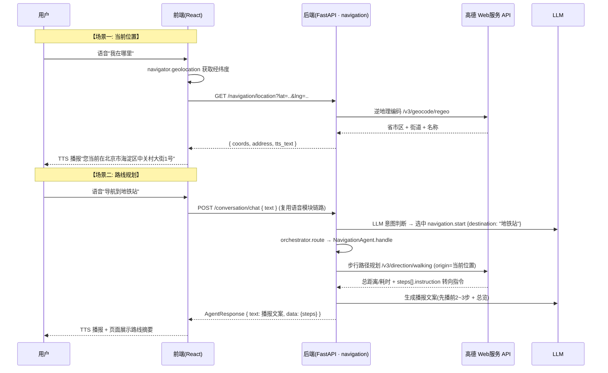

# 导航模块开发思路（人B）

> 版本: v1(草稿) ｜ 日期: 2026-08-11 ｜ 状态: 待评审
>
> 本文档描述"当前定位 → 路线规划 → 播报引导"这条导航最小闭环的开发思路。
> 归属: Navigation Agent（`agents/navigation/`），按 [backend_design_plan.md](backend_design_plan.md) 分工由人B 负责。
> 范围严格限定: **只做当前定位 + 路线规划**，不扩展其他功能。

---

## 0. 可行性判断（先验证，后设计）

以 `.env` 中已有的 `AMAP_API_KEY` 实测高德 Web 服务 API（2026-08-11）：

| 检查项 | 实测结果 | 结论 |
|---|---|---|
| 高德 逆地理编码 `restapi.amap.com/v3/geocode/regeo` | `INVALID_USER_KEY (10001)` | ❌ **key 无效或未开通「Web服务」API** |
| 高德 步行路线规划 `.../v3/direction/walking` | `INVALID_USER_KEY (10001)` | ❌ 同上 |

**结论：功能可行（高德 Web 服务 API 是成熟公开接口），但当前 key 不可用，需人B 先处理密钥，否则无法联调。**

**⚠️ 待处理（人B）**：登录 [高德开放平台](https://console.amap.com) → 我的应用 → 核对：
1. `AMAP_API_KEY` 是否完整复制（新旧 key 格式不同）；
2. 该应用是否已开通「Web服务」下的**逆地理编码**与**路径规划（步行）**两个 API（新应用默认全关，需手动申请）；
3. 若开通了「数字签名」模式，需在后端增加 SHA1 签名参数（本设计预留该开关位）。

备选方案（key 始终无法修复时评估）：百度地图 Web 服务 API（需新申请 key）。

---

## 1. 目标与范围

**功能需求**: 用户语音说出"我在哪/我的位置" → 播报当前位置；说出"导航到XX" → 规划步行路线并播报怎么走。

**本期范围**:

| 做 | 不做（预留/明确排除） |
|---|---|
| 当前定位（浏览器 GPS → 高德逆地理编码 → 地址播报） | POI 周边搜索（`navigationService.ts` 占位保留） |
| 步行路线规划（起点/终点 → 高德步行路径 → 播报文案） | 视觉避障/障碍物检测（下期） |
| 播报文案 LLM 润色（先播前几步 + 总距离/耗时） | WebSocket 实时逐段导航（`/ws/navigation`，下期） |
| 失败降级链（GPS 失败 → IP 粗定位 → 明确失败提示） | 导航历史落库（`navigation_history` 表预留，本期不写） |
| — | 驾车/公交路线（视障用户以步行为主） |

> 高德密钥相关配置若开启「数字签名」，本期实现时一并加上签名逻辑。

## 2. 现状盘点（已有资产，尽量复用）

| 位置 | 现状 | 复用点 |
|---|---|---|
| [backend/.env](backend/.env) | `AMAP_API_KEY` 已配置（⚠️ 当前无效，见 §0） | 修复后直接读取 |
| [backend/app/config.py](backend/app/config.py) | `Settings.AMAP_API_KEY` 字段已定义 | 无需改动 |
| [backend/app/agents/navigation/](backend/app/agents/navigation/) | `agent.py` 占位（"导航功能开发中"）、`api.py` 骨架、`service/placeholder.py` | 在此目录实现 |
| [backend/app/agents/orchestrator.py](backend/app/agents/orchestrator.py) | `INTENT_ROUTING: navigation → navigation` 已映射 | 无需改动 |
| [backend/app/agents/conversation/service/tools.py](backend/app/agents/conversation/service/tools.py) | `navigation.start` 工具已注册（挂 `_log_only` 占位），参数 schema 为 `{destination}` | 真实实现后由人A 替换 handler |
| [backend/app/core/agent_protocol.py](backend/app/core/agent_protocol.py) | 冻结契约 `AgentRequest`/`AgentResponse` | `handle()` 返回体用它 |
| [backend/app/core/llm.py](backend/app/core/llm.py) | `complete()` 已实现（星火/千问双供应商） | 播报文案润色 |
| [backend/app/utils/geo.py](backend/app/utils/geo.py) | 地理工具占位 | 坐标校验/距离计算 |
| [frontend/src/services/navigationService.ts](frontend/src/services/navigationService.ts) | `planRoute()` / `getCurrentLocation()` 占位已写好 | 替换 TODO |
| [frontend/src/pages/NavigationPage.tsx](frontend/src/pages/NavigationPage.tsx) | 页面骨架已有 | 接真实逻辑 |

## 3. 总体架构与数据流



**一次语音导航请求的完整链路** = 语音模块 ASR → LLM 意图（工具注册表）→ 本模块 `handle()` → 高德 → 播报文案 → TTS，本模块只实现 `handle()` 与 REST 端点两部分。

## 4. 关键设计决策

### 4.1 高德 Web 服务 REST API + 后端代理

- 用**后端代理**调用高德 REST 接口，`AMAP_API_KEY` 只存在于服务端（放前端会暴露 key、受域名/IP 白名单限制）；
- 只用步行模式 `/v3/direction/walking`：视障用户不驾车，且步行接口返回每步的 `instruction`（中文转向提示，如"沿中关村大街向东北步行 120 米"），可直接作为播报素材。

### 4.2 定位三级降级链

| 优先级 | 方案 | 说明 |
|---|---|---|
| 1 | 浏览器 `navigator.geolocation` | 精度最高；要求 HTTPS（`localhost` 开发可用）；前端拿坐标后传给后端做逆地理编码 |
| 2 | 高德 IP 定位 `/v3/ip` | GPS 被拒/超时时降级，只返回城市级粗定位 |
| 3 | 明确失败播报 | "定位失败，请检查定位权限" |

> 后端不主动要位置权限，位置获取放前端（浏览器权限模型要求），后端只做"坐标 → 地址"转换。

### 4.3 播报文案策略（LLM 润色 + 截断）

- 一次播报不念完所有步骤（盲人记不住），LLM 只润色**总览 + 前 2~3 步**："全程 1.2 公里，大约需要 18 分钟。先沿中关村大街向北走 200 米，在第一个路口左转…"；
- `data` 里返回全部 steps，供页面展示与下期逐段导航；
- LLM 润色失败时直接拼原始 instruction 兜底（宁可念原始指令，不可不念）。

### 4.4 与语音模块工具链的衔接

- `TOOL_REGISTRY` 中 `navigation.start` 已注册，本期由人A 把 `_log_only` 替换为 `agent.handle(AgentRequest)`；
- 本模块 `handle()` 支持 intent：`navigation`（参数 `{destination, origin?}`）；
- 位置上下文：`AgentRequest.context` 可携带前端传入的坐标（`lat/lng`），无坐标时后端用 IP 粗定位兜底。

## 5. 后端实现方案

### 5.1 新增/改动文件清单

```
backend/app/agents/navigation/
├── api.py                      # 改: 挂 GET /navigation/location、POST /navigation/route
├── schemas.py                  # 改: LocationOut/RouteRequest/RouteOut
├── agent.py                    # 改: handle() 实现 navigation 意图
└── service/
    ├── amap.py                 # 新: 高德客户端(regeo/walking/ip, HMAC/签名预留, 超时与错误包装)
    ├── navigation.py           # 新: 路线编排(调高德→解析steps→LLM润色文案)
    └── placeholder.py          # 删/保留(不再被引用)
```

### 5.2 高德客户端（`service/amap.py`）

```python
class AmapError(Exception):
    """高德 API 失败(超时/参数/key无效)。status=0 时抛错,调用方兜底。"""

class AmapClient:
    BASE = "https://restapi.amap.com/v3"
    # 签名开关: 若控制台开通了"数字签名", 需对请求参数 + key 做 SHA1 签名(预留)
    def __init__(self, key: str): ...
    async def regeo(self, lat: float, lng: float) -> dict:
        # GET /geocode/regeo?key=&location={lng},{lat} → formatted_address / city
    async def walking(self, origin: tuple, dest: tuple) -> dict:
        # GET /direction/walking?key=&origin={lng},{lat}&destination=...
        #   → route.paths[0]: {distance(m), duration(s), steps[{instruction, distance}]}
    async def ip_location(self) -> dict:
        # GET /ip?key= → 城市级粗定位(降级链第2级)
```

要点：
- 每次调用设超时（`httpx` 8s），失败抛 `AmapError`，由路由层转错误码（见 §8）；
- 高德返回 `status:"0"` 时 `info` 里有原因（如 `INVALID_USER_KEY`），**统一记日志**便于排查 key 问题；
- 坐标顺序易错：高德 `location` 参数为 **经度,纬度**，入参先校验范围（纬度 -90~90，经度 -180~180）。

### 5.3 路线编排（`service/navigation.py`）

```python
async def plan_route(destination: str, origin: tuple | None) -> dict:
    # 1. 起点: 前端坐标 > IP 粗定位 > 直接失败(让用户确认)
    # 2. amap.walking(origin, 终点坐标) —— 终点是"地址字符串"时需先 geocode
    #    (目的地为模糊名称时: 本期直接交给高德 walking 的 destination=地址文本,
    #    高德支持直接传地址词; 解析失败返回 40200 让用户换个说法)
    # 3. 解析 paths[0]: distance / duration / steps
    # 4. llm.complete 润色播报文案(system: 你是导航播报员, 只输出口语化播报文本,
    #    先总览后前2~3步; 失败则拼接原始 instruction 兜底)
    # 5. 返回 {summary, steps, tts_text}
```

### 5.4 `handle()` 与 API

```python
async def handle(self, req: AgentRequest) -> AgentResponse:
    # intent == "navigation": params["destination"] 必填
    #   data = await plan_route(dest, origin=req.context.get("coords"))
    #   return AgentResponse(text=data["tts_text"], action="navigate", data=data)
```

API 定义见 §6；两个端点都只做"查"不做"存"（导航历史落库列为预留，见 §9）。

## 6. API 接口定义

```http
### 1) 当前位置(逆地理编码)
GET /api/v1/navigation/location?lat=39.90923&lng=116.397428
→ 200 { code: 200, data: {
      coords: { lat, lng },
      address: "北京市海淀区中关村大街1号",
      city: "北京市",
      source: "gps" | "ip",
      tts_text: "您当前在北京市海淀区中关村大街1号"
    }, request_id }

### 2) 路线规划
POST /api/v1/navigation/route      # { destination, origin?: {lat, lng} }
→ 200 { code: 200, data: {
      summary: { distance_m: 1200, duration_min: 18,
                 start_address, end_address },
      steps: [ { instruction: "沿中关村大街向东北步行120米", distance_m: 120 } ],
      tts_text: "全程1.2公里，大约需要18分钟。先沿…"
    }, request_id }
```

错误码沿用 [errors.py](backend/app/core/errors.py) 体系：
- `40001` 参数错（坐标越界/目的地为空）→ "请再说一次目的地"；
- `40200` 目的地解析失败 → "没有找到这个地方，请换个说法"；
- `50020` 高德不可用/key 无效 → "导航服务暂不可用，请稍后再试"（日志记录具体 `info`）。

## 7. 前端实现方案

| 文件 | 改动 |
|---|---|
| [navigationService.ts](frontend/src/services/navigationService.ts) | 替换 TODO：`getCurrentLocation()` 先调 `navigator.geolocation` 拿坐标再请求后端；`planRoute(origin, destination)` 调 `/navigation/route` |
| [NavigationPage.tsx](frontend/src/pages/NavigationPage.tsx) | 接线：定位按钮（点按播报当前位置）、目的地输入 + 规划按钮、路线摘要卡片（距离/耗时/前几步）；语音入口沿用 MainPage 全局麦克风 |
| 位置权限 | `navigator.geolocation.getCurrentPosition` 失败时提示"请在浏览器设置中允许定位" |

> 生产部署要求 HTTPS，否则浏览器拒绝 geolocation；`localhost` 开发不受限。

## 8. 错误处理与兜底

| 环节 | 失败场景 | 处理 |
|---|---|---|
| 定位 | 浏览器权限被拒/超时 | 降级 IP 粗定位 → 仍失败则播报"定位失败，请检查定位权限" |
| 逆地理编码 | 高德返回 status=0 | 返回"无法确定您的具体位置"，日志记录 info |
| 路线规划 | 目的地解析不到 | "没有找到这个地方，请换个说法" |
| 路线规划 | 高德超时 | 50010 网络超时 → "网络超时，请稍后再试" |
| LLM 润色 | 失败/超时 | 直接拼接高德原始 instruction 播报，不阻塞导航 |

## 9. 预留扩展点（下期）

1. **POI 周边搜索**：`/navigation/poi`（前端占位已存在），"最近的药店/地铁站"场景；
2. **WebSocket 实时逐段导航**：`/ws/navigation`，已播报的步骤标记完成、提前播报下一段；
3. **导航历史**：`navigation_history` 表落库（backend_design_plan §5.1 已设计），本期不写；
4. **障碍物检测**：与感知模块视觉能力联动（下期）。

## 10. 实施步骤（里程碑）

| # | 内容 | 验证方式 |
|---|---|---|
| M1 | 高德 key 修复：控制台开通 Web服务 + 逆地理编码 + 步行路径规划 | `curl "…/v3/geocode/regeo?key=…"` 返回 status=1 |
| M2 | 定位：`amap.py` regeo + `GET /navigation/location` + 前端 geolocation 接线 | 浏览器访问 NavigationPage，点定位播报出当前位置 |
| M3 | 路线规划：walking + 文案润色 + `POST /navigation/route` | `curl -X POST …/navigation/route -d '{"destination":"地铁站"}'` 返回 steps 与 tts_text |
| M4 | 语音接通：人A 把 `navigation.start` handler 换成真实调用 | 对麦克风说"导航到XX"→ TTS 播报路线 |

## 11. 风险与注意事项

- **高德 key 是当前唯一硬阻塞**：`INVALID_USER_KEY` 未解决前 M2/M3 无法联调，参考 §0 排查清单；
- 浏览器定位必须 HTTPS（生产环境），提前确认部署域名有证书；
- 高德步行规划对超长距离（>100km）不支持，播报兜底提示"距离太远，建议乘车"（下期接公交/驾车模式）；
- 高德 `location` 参数顺序是 **经度,纬度**，前后端传参格式要统一（前端传 `{lat, lng}`，后端转换）；
- 坐标与地址均属位置隐私：日志只记城市级，不记精确坐标；`navigation_history` 落库前需评估脱敏。
