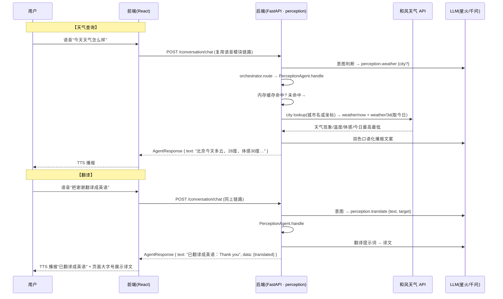

# 感知模块开发思路（人D：天气查询 + 翻译）

> 版本: v1(草稿) ｜ 日期: 2026-08-11 ｜ 状态: 待评审
>
> 本文档描述感知模块本期两个能力的开发思路：**天气查询、翻译**。
> 归属: Perception Agent（`agents/perception/`），由人D 负责。
> 范围严格限定: 只做这两个功能，不做 OCR/物体识别/场景理解/政策问答/提醒（按 [backend_design_plan.md](backend_design_plan.md) 为后续阶段）。

---

## 0. 可行性判断（先验证，后设计）

以 `.env` 现有密钥实测（2026-08-11）：

| 检查项 | 实测结果 | 结论 |
|---|---|---|
| 和风天气 城市搜索 `geoapi.qweather.com` | HTTP 404 | ❌ **key 当前不可用** |
| 和风天气 实时天气 `devapi.qweather.com` | 403 `Invalid Host` | ❌ 同上 |
| 和风天气 付费 host `api.qweather.com` | 403 `Invalid Host` | ❌ 同上 |
| 文本 LLM `qwen3.7-flash`（翻译用） | 正常返回 | ✅ 可用 |
| 讯飞星火 LLM（语音模块已接入） | 34 测试通过（2026-08-10） | ✅ 备选供应商 |
| 专用翻译模型 | `qwen-mt-flash` / `qwen-mt-plus` / `qwen3.5-livetranslate-flash` 均在模型列表 | ✅ 可选 |
| 高德天气（备选） | 高德 key 同为 `INVALID_USER_KEY`（见导航模块 §0） | ❌ 同步待修复 |

**结论：翻译零阻塞（现有 LLM 即可）；天气功能可行但和风 key 当前不可用，需人D 先处理密钥。**

**⚠️ 待处理（人D）**：登录 [和风天气控制台](https://console.qweather.com) → 项目管理，核对：
1. `QWEATHER_API_KEY` 是否为该项目下的有效 key（注意与"密钥""凭据"多 key 区分）；
2. 项目是否已添加 **免费订阅** 并勾选所需的 API（城市搜索 / 实时天气 / 3日预报），未订阅任何 API 时 host 会直接 403/404；
3. 免费订阅应使用 `devapi.qweather.com` 域名（本设计按免费域名写；若订阅的是付费版需换 `api.qweather.com`，做成配置项）。

---

## 1. 目标与范围

**功能需求**:
- **天气查询**: 用户语音"今天天气怎么样" → 播报城市、天气现象、温度、体感、今日最高最低；
- **翻译**: 用户语音"把'谢谢'翻译成英语" → 展示并播报译文（中文说明 + 译文文本展示）。

**本期范围**:

| 做 | 不做（预留/明确排除） |
|---|---|
| 天气查询：城市搜索 + 实时天气 + 今日最高/最低 → 播报 | 未来 3 天逐日预报（下期加 `/weather/3d` 全量） |
| 30 分钟内存缓存（单实例） | 外语语音输入（讯飞 ASR 为中文引擎，本期不做） |
| 翻译：中文 → 英/日/韩/法/德/西等常见语种（LLM 判定） | 译文语音朗读（下期，需英文音色） |
| 翻译结果页面展示（供对方查看） | 政策问答/OCR/物体识别/提醒（后续阶段） |

> 与 backend_design_plan §5.3 的差异说明：原设计天气缓存落 `weather_cache` 表，本期单实例先用**内存 TTL 缓存**（更快、零 DB 依赖），多实例阶段再落表。

## 2. 现状盘点（已有资产，尽量复用）

| 位置 | 现状 | 复用点 |
|---|---|---|
| [backend/.env](backend/.env) | `QWEATHER_API_KEY` 已配置（⚠️ 当前无效，见 §0） | 修复后直接读取 |
| [backend/app/config.py](backend/app/config.py) | `Settings.QWEATHER_API_KEY` 已定义 | 无需改动 |
| [backend/app/agents/perception/](backend/app/agents/perception/) | `agent.py` 占位、`weather/` 空目录、`service/placeholder.py` | 在 `weather/` 下实现 |
| [backend/app/agents/orchestrator.py](backend/app/agents/orchestrator.py) | `INTENT_ROUTING: weather → perception` 已映射 | 翻译需人A 补一行 `translate → perception` |
| [backend/app/agents/conversation/service/tools.py](backend/app/agents/conversation/service/tools.py) | `perception.weather` 工具已注册（挂 `_log_only`），参数 `{city}` | 真实实现后由人A 替换 handler |
| [backend/app/core/llm.py](backend/app/core/llm.py) | `complete()` 已实现（星火/千问双供应商） | 翻译 + 天气播报文案润色 |
| [backend/app/core/agent_protocol.py](backend/app/core/agent_protocol.py) | 冻结契约 `AgentRequest`/`AgentResponse` | `handle()` 返回体用它 |
| [frontend/src/services/perceptionService.ts](frontend/src/services/perceptionService.ts) | `getWeather(city)` 占位已写好 | 替换 TODO |
| [frontend/src/pages/](frontend/src/pages/) | 天气/翻译入口暂挂 MainPage 或新增卡片 | 接线 |

## 3. 总体架构与数据流



## 4. 关键设计决策

### 4.1 天气：和风天气 v7 + 两级解析 + 30min 缓存

- **城市解析优先级**：①工具参数 `city`（用户说城市名）→ ②前端定位坐标（`/geoapi/v2/city/lookup?location=经度,纬度` 反查城市）→ ③都不给时用高德 IP 定位兜底（高德 key 修复后可用），再不行提示"请告诉我城市名"；
- **数据取用**：`weather/now`（温度/天气/体感/湿度/风）+ `weather/3d` 取 `daily[0]` 的今日最高最低 —— 播报"现在 XX 度，XX 天气，体感 XX 度，今天最高 XX 度"；
- **缓存**：内存 dict + TTL 30min，key = 城市 ID（`LocationID`），命中直接返回，不重复打外部 API（和风免费订阅有调用限额）。

### 4.2 翻译：通用 LLM 为主，专用模型为备选

- **主方案（零新增凭据）**：用现有 `core/llm.py`（星火/千问），system 提示词"你是翻译助手，只输出译文，不解释"——语音链路已验证，最稳；
- **备选方案**：`qwen-mt-flash` 专用翻译模型（已在模型列表，DashScope 兼容接口可调），若通用模型翻译质量/语种不够时切换；
- **语种判定**：`target_lang` 由 LLM 从用户话语解析（"翻译成英语"→ en）；用户未说明目标语种 → 返回 `needs_followup=True`，追问"翻译成什么语言？"；
- **语种白名单**：MVP 支持 英/日/韩/法/德/西/俄/阿拉伯（LLM 能力内的常见语种），不在白名单回退中文说明。

### 4.3 播报策略：中文说明 + 译文展示

- 视障用户对老外说话场景：TTS 播报**中文说明**（"已翻译成英语：Thank you"），译文用**页面大字号展示**给对方看；
- 译文朗读预留：讯飞 TTS 可配英文音色，下期加"播报原文音"开关。

### 4.4 与语音模块工具链的衔接

- `perception.weather` 已在 `TOOL_REGISTRY`，由人A 把 handler 替换为真实调用；
- 新增 `perception.translate` 工具（参数 `{text, target_lang?}`）与 `INTENT_ROUTING` 的 `translate` 项，由人A 登记；
- 本模块 `handle()` 支持 intent：`weather` / `translate`。

## 5. 后端实现方案

### 5.1 新增/改动文件清单

```
backend/app/agents/perception/
├── api.py                      # 改: 挂 GET /perception/weather、POST /perception/translate
├── schemas.py                  # 改: WeatherOut/TranslateRequest/TranslateOut
├── agent.py                    # 改: handle() 分发 weather/translate
└── service/
    ├── weather.py              # 新: 和风客户端(city lookup + now + 3d) + 内存TTL缓存
    └── translate.py            # 新: LLM 翻译(语种解析/白名单/追问)
```

### 5.2 天气服务（`service/weather.py`）

```python
# 免费订阅域名; 若用户订阅付费版换 api.qweather.com(做成配置项 QWEATHER_BASE_URL)
GEO_BASE = "https://geoapi.qweather.com/v2/city/lookup"
NOW_URL  = "https://devapi.qweather.com/v7/weather/now"
DAILY_URL = "https://devapi.qweather.com/v7/weather/3d"

class QWeatherError(Exception): ...

_cache: dict[str, tuple[float, dict]] = {}   # {city_id: (expire_ts, data)}, TTL=30min

async def get_weather(city: str | None, coords: tuple | None) -> dict:
    # 1. city 为空且有坐标 → geo city/lookup?location={lng},{lat} 反查 LocationID
    #    city 非空 → geo city/lookup?location={city}
    # 2. _cache 命中直接返回; 未命中 → now + 3d(daily[0])
    # 3. llm 润色播报文案("北京现在多云28度, 体感30度, 今天最高33度最低24度")
    # 4. 写缓存; 失败(401/403/404)抛 QWeatherError → 路由层转错误码
```

要点：和风响应 `code` 字段为业务码（`200` 成功；`401` key 无效；`403` host 无权；`404` 项目未开通该 API）——**全部记日志**，便于排查 §0 的 key 问题。

### 5.3 翻译服务（`service/translate.py`）

```python
LANG_WHITELIST = {"en": "英语", "ja": "日语", "ko": "韩语", "fr": "法语",
                  "de": "德语", "es": "西班牙语", "ru": "俄语", "ar": "阿拉伯语"}

async def translate(text: str, target_lang: str | None) -> dict:
    # 1. target 为空 → 由 LLM 从原文解析("把…翻译成英语"→en); 仍为空 → needs_followup
    # 2. llm.complete(system="你是翻译助手, 只输出译文本身, 不要解释",
    #                 prompt=f"把下面这段话翻译成{目标语}:\n{text}")
    # 3. 返回 {translated_text, target_lang, tts_text: f"已翻译成{中文名}：{译文}"}
```

### 5.4 `handle()` 与 API

```python
async def handle(self, req: AgentRequest) -> AgentResponse:
    if req.intent == "weather":
        data = await weather.get_weather(req.params.get("city"),
                                         req.context.get("coords"))
        return AgentResponse(text=data["tts_text"], action=None, data=data)
    if req.intent == "translate":
        r = await translate.translate(req.params.get("text", ""),
                                      req.params.get("target_lang"))
        if r.get("needs_followup"):
            return AgentResponse(text="您想翻译成什么语言？", needs_followup=True)
        return AgentResponse(text=r["tts_text"], data=r)
    return AgentResponse(text="感知助手开发中，请稍后再试", ...)
```

## 6. API 接口定义

```http
### 1) 天气查询
GET /api/v1/perception/weather?city=北京        # 或 ?lat=39.9&lng=116.4
→ 200 { code: 200, data: {
      city: "北京", location_id: "101010100",
      now: { temp_c: 28, feels_like_c: 30, text: "多云", humidity: 60, wind: "南风3级" },
      today: { high_c: 33, low_c: 24 },
      cached: false,
      tts_text: "北京现在多云，28度，体感30度，今天最高33度，最低24度"
    }, request_id }

### 2) 翻译
POST /api/v1/perception/translate    # { text: "谢谢", target_lang: "en" }
→ 200 { code: 200, data: {
      translated_text: "Thank you", target_lang: "en", target_name: "英语",
      tts_text: "已翻译成英语：Thank you"
    }, request_id }
    # target_lang 缺省且无法判定: 200 { data: { needs_followup: true } }
```

错误码沿用 [errors.py](backend/app/core/errors.py) 体系：
- `40001` 参数错（翻译文本为空）→ "请说出要翻译的内容"；
- `40200` 城市查不到 → "没找到这个城市，请换个说法"；
- `50020` 和风不可用/key 无效 → "天气服务暂不可用，请稍后再试"（日志记录 code 字段）；
- `50010` 外部超时 → "网络超时，请稍后再试"。

## 7. 前端实现方案

| 文件 | 改动 |
|---|---|
| [perceptionService.ts](frontend/src/services/perceptionService.ts) | `getWeather(city)` 替换 TODO（支持传坐标参数）；新增 `translate(text, target_lang)` |
| MainPage / 新卡片 | 天气卡片：点按播报当前天气（复用定位坐标）；翻译卡片：输入框 + 目标语种选择 + 译文大字号展示区 |
| 定位传递 | 调用天气时把已获取的浏览器坐标随请求带上（无则仅城市名） |

## 8. 错误处理与兜底

| 环节 | 失败场景 | 处理 |
|---|---|---|
| 天气 | 和风 401/403/404 | "天气服务暂不可用"，日志记录业务 code（key 排查依据） |
| 天气 | 城市名查不到 | "没找到这个城市，请换个说法"（40200） |
| 天气 | 无城市名且无定位 | "请告诉我您所在的城市"（40001） |
| 天气 | 缓存失效且外部超时 | 若有旧缓存 → 播报旧数据并说明"数据为 X 分钟前"；无 → 50010 |
| 翻译 | LLM 失败 | 重试 1 次 → "翻译服务繁忙，请稍后再试" |
| 翻译 | 语种无法判定 | 追问"翻译成什么语言？"（needs_followup，不瞎猜） |
| 全链路 | 隐私 | 天气/翻译文本进 conversation_logs 时按既有脱敏规则（不含位置精确坐标） |

## 9. 预留扩展点（下期）

1. **未来 3 天预报**：`weather/3d` 全量输出，播报"明天多云转晴"；
2. **译文朗读**：讯飞 TTS 英文音色，播报译文原文；
3. **天气提醒联动**：恶劣天气（暴雨/台风预警）→ Perception·reminder 主动提醒；
4. **OCR/物体识别/政策问答**：`perception/` 下 `ocr/`、`vision/`、`policy/` 目录已预留，后续阶段。

## 10. 实施步骤（里程碑）

| # | 内容 | 验证方式 |
|---|---|---|
| M1 | 和风 key 修复：控制台确认 key + 订阅 API（城市搜索/实时天气/3日预报） | `curl "…/v7/weather/now?key=…&location=101010100"` 返回 `code: 200` |
| M2 | 天气：`weather.py`（lookup + now + 3d + 缓存）+ `GET /perception/weather` | curl 带 `?city=北京` 返回数据与播报文案；二次请求 `cached: true` |
| M3 | 翻译：`translate.py` + `POST /perception/translate` | curl `{"text":"谢谢","target_lang":"en"}` 返回 "Thank you" |
| M4 | 前端接线 + 语音接通（人A 替换 `perception.weather` handler、登记 `perception.translate`） | 对麦克风说"今天天气怎么样"/"把谢谢翻译成英语"→ TTS 播报 |

## 11. 风险与注意事项

- **和风 key 是天气功能的硬阻塞**：403/404 未解决前 M2 无法联调（§0 排查清单）；
- 和风免费订阅有每日调用限额（约 1000 次/日），**缓存必须实现**，否则 QPS 一高就撞限额；
- 翻译是"说中文 → 给对方看译文"的交互，前端译文展示字号要够大（视障用户朋友/路人需要看清）；
- 语种判定错误会导致闹笑话：LLM 解析不出目标语种时一律追问，不默认英文；
- 天气播报文本要口语化（LLM 润色），避免直接念 API 原文。
