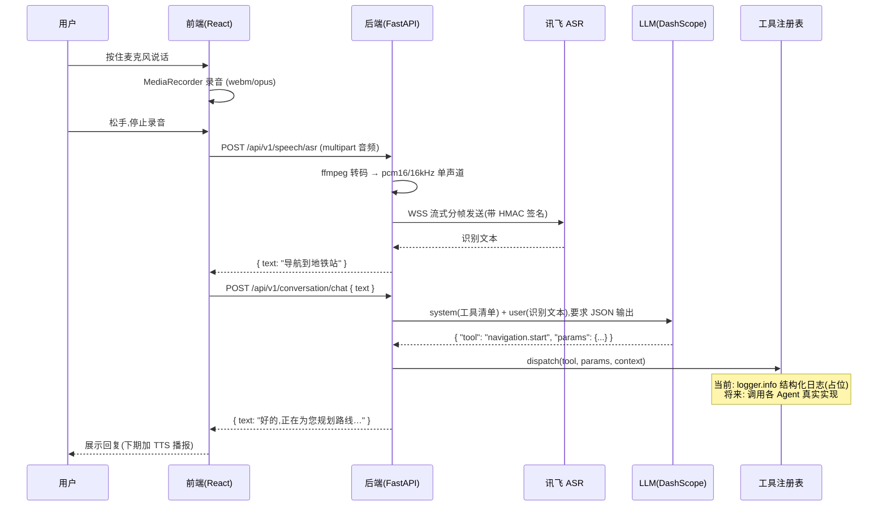

# 语音模块开发思路

> 版本: v1(草稿) ｜ 日期: 2026-08-10 ｜ 状态: 待评审
>
> 本文档描述"语音输入 → ASR 识别 → LLM 意图判断 → 工具调用(暂为日志占位)"这条最小闭环的开发思路。
> 目标:**先跑通链路,再填实现** —— 所有外部工具尚未开发,先以结构化日志输出预留调用空间。

---

## 0. 目标与范围

**功能需求**:用户点击前端麦克风说话 → 语音被识别为文字 → 文字交给 LLM → LLM 判断意图并调用其他 Agent 工具 → 工具暂未实现,用日志输出,预留调用空间。

**本期范围**:

| 做 | 不做(预留) |
|---|---|
| 前端按住说话、录音、上传 | TTS 语音播报(下期) |
| 讯飞 ASR 识别中文 | WebSocket 流式对话(下期) |
| LLM 工具调用框架 + 日志占位 | 真实工具实现(各 Agent 后续开发) |
| 文本回复展示 | 对话历史持久化(下期) |

## 1. 现状盘点(已有资产,尽量复用)

| 位置 | 现状 | 复用点 |
|---|---|---|
| [backend/.env](backend/.env) | `XFYUN_APP_ID/API_KEY/API_SECRET`、`DASHSCOPE_API_KEY` 已配置 | 无需新增配置 |
| [backend/app/config.py](backend/app/config.py) | `Settings` 已含讯飞/DashScope 字段 | 直接读取 |
| [backend/app/core/llm.py](backend/app/core/llm.py) | `complete()` 占位,抛 `NotImplementedError` | 实现它即可 |
| [backend/app/agents/conversation/api.py](backend/app/agents/conversation/api.py) | 已声明 `/speech/*` 路由归属 | 在此挂路由 |
| [backend/app/agents/orchestrator.py](backend/app/agents/orchestrator.py) | `INTENT_ROUTING` 硬编码路由表,已有"接入 LLM 意图分类"TODO | LLM 判断结果接入 `route()` |
| [backend/app/core/agent_protocol.py](backend/app/core/agent_protocol.py) | 冻结契约 `AgentRequest`/`AgentResponse` | 工具调用的返回体用它 |
| [backend/app/utils/audio.py](backend/app/utils/audio.py) | `convert_audio_format()` 占位 | 实现转码 |
| [frontend/src/components/VoiceButton.tsx](frontend/src/components/VoiceButton.tsx) | 按钮 UI 已有,无录音逻辑 | 接录音逻辑 |
| [frontend/src/services/speechService.ts](frontend/src/services/speechService.ts) | 已写好 `speechToText()` 骨架(FormData 上传 `/speech/asr`) | 换成真实实现 |
| [frontend/src/services/api.ts](frontend/src/services/api.ts) | baseURL=`/api/v1`,带 JWT 拦截器 | 无需改动 |

## 2. 总体架构与数据流



**一次完整请求 = 两个 HTTP 接口串行**(职责单一,便于独立调试):

1. `/speech/asr` —— 纯识别,只做"语音 → 文本"
2. `/conversation/chat` —— 纯文本进 LLM + 工具分发,不做音频

> 为什么不合成一个接口?ASR 与 LLM 是两类外部服务,分开后任一步出错都能独立定位、单独重试,也便于后续用 WebSocket 流式替换 ASR 环节而不动 LLM 链路。

## 3. 关键设计决策

### 3.1 传输方式:HTTP 一次性上传(v1),WebSocket 流式(下期)

- 交互是"按住说话 → 松手"的一次性录音,不是连续对话,HTTP multipart 上传最简单可靠;
- 前端 `speechService.ts` 占位接口本就是 HTTP,改动最小;
- 后端调用讯飞时仍用它的 **WebSocket 流式接口**(讯飞 iat 只提供流式),这与前后端传输方式无关;
- 下期做"边说边识别"的实时体验时,再启 `/ws/chat`,复用 [backend/app/core/websocket.py](backend/app/core/websocket.py) 的 `ConnectionManager`。

### 3.2 LLM 工具调用:JSON 协议 + 注册表,不用原生 function calling

- DashScope 走 OpenAI 兼容 HTTP 接口,用 `response_format: {"type": "json_object"}` + 系统提示词里声明工具清单,输出结构化 JSON —— 简单、可控、不绑 SDK;
- 定义**工具注册表**:工具名 → {描述、参数 Schema、handler、归属 Agent 模块}。LLM 只负责选工具、填参数,执行走注册表 —— 这就是"预留调用其他工具的空间";
- 工具调用结果统一包装成现有冻结契约 `AgentResponse`(见 [agent_protocol.py](backend/app/core/agent_protocol.py)),不另立协议。

### 3.3 归属:语音闭环放 Conversation 模块

按 [导盲AI智能体设计方案.md](导盲AI智能体设计方案.md) §2.1 的分工,ASR/TTS、Orchestrator(LLM 路由)都归 Conversation 负责人。因此新代码放 `agents/conversation/` 下,不另起 `app/speech/` 顶层目录,避免与既有归属冲突。

## 4. 后端实现方案

### 4.1 新增/改动文件清单

```
backend/app/agents/conversation/
├── api.py                      # 改: 挂 POST /speech/asr、POST /conversation/chat
├── schemas.py                  # 改: 补 ASRRequest/ChatRequest 等
└── service/
    ├── asr.py                  # 新: 讯飞 ASR 客户端(签名 + 分帧 + 结果拼接)
    ├── chat.py                 # 新: 文本 → LLM → 工具分发 → 回复(编排层)
    └── tools.py                # 新: 工具注册表 + 占位 handler ★核心预留点

backend/app/core/llm.py         # 改: 实现 complete(),支持 json_mode
backend/app/utils/audio.py      # 改: 实现 convert_audio_format()(ffmpeg 转码)
backend/app/config.py           # 改: 补语音相关非敏感配置项(采样率/超时/URL)
backend/config/config.yaml      # 改: 新增 speech 配置段(非敏感项)
```

### 4.2 讯飞 ASR 客户端(`service/asr.py`)

接入讯飞**语音听写(iat)** WebSocket 流式接口,要点:

| 项 | 说明 |
|---|---|
| 地址 | `wss://iat-api.xfyun.cn/v2/iat`(中文) |
| 认证 | RFC1123 日期 + `host/date/request-line` 拼接 → HMAC-SHA256(用 `XFYUN_API_SECRET`)→ base64 得签名,放入 `Authorization` 头;签名失败常见原因:应用未开通"语音听写"服务 |
| 音频要求 | PCM 16kHz 16bit 单声道(raw 裸流) |
| 分帧发送 | 每帧 160ms(=5120 字节),首帧带 `status=0` + 业务参数(`language=zh_cn, domain=iat, accent=mandarin`),中间帧 `status=1`,末帧 `status=2` 表示音频发完 |
| 结果拼接 | 每帧返回 `data.result.ws[].cw[].w` 增量文本,累加;`data.status=2` 时识别结束 |
| 超时 | 建连 + 首帧 5s,整体 15s,超时按"没听清"兜底 |

签名代码骨架(占位,实现时补全):

```python
def build_auth_header(api_key: str, api_secret: str) -> str:
    # 1. date = RFC1123 格式
    # 2. signature_origin = f"host: {HOST}\ndate: {date}\nGET {PATH} HTTP/1.1"
    # 3. signature = base64(HMAC-SHA256(api_secret, signature_origin))
    # 4. return f'api_key="{api_key}", algorithm="hmac-sha256", headers="host date request-line", signature="{signature}"'
```

### 4.3 音频转码(`utils/audio.py`)

前端 MediaRecorder 产出 `webm/opus`,讯飞要 `pcm16/16kHz`,必须转码:

- 用 `ffmpeg`(subprocess):`ffmpeg -i in.webm -ar 16000 -ac 1 -f s16le out.pcm`;
- 或加 `pydub` 依赖(底层仍是 ffmpeg);**Windows 需先安装 ffmpeg 并加入 PATH**;
- 顺带做上传大小限制(如 ≤5MB)与空音频拦截(体积 < 1KB 直接返回"没有听到声音")。

### 4.4 LLM 工具调用 —— 核心设计(`service/tools.py` + `service/chat.py`)

#### 4.4.1 工具注册表(★预留空间所在)

```python
# service/tools.py —— 工具注册表
@dataclass
class ToolSpec:
    name: str                    # 工具名,如 "navigation.start"
    description: str             # 给 LLM 看的说明(动态拼进 system prompt)
    params_schema: dict          # 参数 JSON Schema(给 LLM 看)
    agent_module: str | None     # 对应 Agent 模块(navigation/safety/perception...)
    handler: Callable            # async (params, context) -> dict

TOOL_REGISTRY: dict[str, ToolSpec] = {
    "navigation.start": ToolSpec(
        name="navigation.start",
        description="规划前往某地的步行导航路线。用户表达出行/去某地意图时使用。",
        params_schema={"type": "object", "properties": {"destination": {"type": "string"}}, "required": ["destination"]},
        agent_module="navigation",
        handler=_log_only,
    ),
    # 预留清单(本期全部挂 _log_only):
    # "safety.sos"          → agent_module="safety"      (SOS 求救)
    # "perception.weather"  → agent_module="perception"  (天气查询)
    # "perception.reminder" → agent_module="perception"  (提醒设置)
    # "perception.vision"   → agent_module="perception"  (图像理解,下期)
}
```

#### 4.4.2 占位 handler(日志输出,本期所有工具都挂它)

```python
async def _log_only(params: dict, context: dict, tool: ToolSpec) -> dict:
    """工具占位实现:结构化日志输出,预留真实实现入口。"""
    logger.info(
        "【工具调用·占位】tool=%s agent_module=%s params=%s context=%s",
        tool.name, tool.agent_module, json.dumps(params, ensure_ascii=False), json.dumps(context, ensure_ascii=False),
    )
    # TODO(各 Agent 开发时): 构造 AgentRequest 调用 orchestrator.route(),
    # 或直接调用真实服务;返回结构应保持 dict,最终包成 AgentResponse。
    return {"status": "not_implemented", "tool": tool.name}
```

> 日志必须**结构化**(JSON 序列化 params/context),后续写测试断言、接真实实现时才有据可查。

#### 4.4.3 编排层(`service/chat.py`)

```python
async def chat(transcript: str, session_id: str, user_id: str) -> AgentResponse:
    # 1. 从 TOOL_REGISTRY 动态生成工具清单文本,作为 system prompt
    # 2. llm.complete(system, transcript, json_mode=True)
    # 3. 解析 JSON: {"tool": "navigation.start"|null, "params": {...}, "chat_reply": "给用户的回复"}
    #    - tool 为空 → 纯聊天,chat_reply 即回复
    #    - tool 存在 → registry.dispatch(tool, params, context={语音原文, session_id, ...})
    #      - 工具不存在/解析失败 → 回退纯聊天
    # 4. 回复统一包装为 AgentResponse(text=chat_reply, ...)
```

- `context` 里带 `transcript`(语音原文)和 `session_id`,为将来真实工具实现备好上下文;
- 与现有 [orchestrator.py](backend/app/agents/orchestrator.py) 的衔接:LLM 判断出的工具 → 通过 `agent_module` 映射到 `INTENT_ROUTING` 的模块名 → 走 `orchestrator.route()`。本期的 `_log_only` 先不调 route,但 `ToolSpec.agent_module` 字段已把对应关系预留好。

#### 4.4.4 `llm.py` complete() 实现要点

- DashScope OpenAI 兼容端点:`POST https://dashscope.aliyuncs.com/compatible-mode/v1/chat/completions`,Bearer `DASHSCOPE_API_KEY`;
- `json_mode=True` 时传 `response_format: {"type": "json_object"}`,并在 system 提示词里强调"只输出 JSON";
- 模型名取 `settings.DASHSCOPE_MODEL`(config.yaml 已配),不硬编码;
- 超时 15s,失败重试 1 次,再失败走兜底回复。

## 5. 前端实现方案

| 文件 | 改动 |
|---|---|
| [hooks/useVoiceRecorder.ts](frontend/src/hooks/) (新) | 封装 `navigator.mediaDevices.getUserMedia` + `MediaRecorder`,导出 `start()` / `stop(): Promise<Blob>` |
| [components/VoiceButton.tsx](frontend/src/components/VoiceButton.tsx) | 接录音逻辑:`onPointerDown` 开始,`onPointerUp/Leave/Cancel` 停止;录音中显示脉冲态(现有 `isListening` 样式已备好) |
| [services/speechService.ts](frontend/src/services/speechService.ts) | 替换 TODO:调 `/speech/asr`(URL 与 baseURL=`/api/v1` 天然对齐,已带 JWT),新增 `sendToLLM(text)` 调 `/conversation/chat` |
| 新增对话展示区 | 识别文本 + LLM 回复列表(简单消息流即可,下期加 TTS 播报) |

前端流程:录音 Blob → `speechToText()` → 展示"我说了什么" → `sendToLLM(text)` → 展示回复。

## 6. API 接口定义

```http
### 1) 语音识别
POST /api/v1/speech/asr            # Content-Type: multipart/form-data,字段 audio
→ 200 { code: 200, data: { text: "导航到地铁站", confidence: 0.96 }, request_id: "..." }

### 2) LLM 对话 + 工具调用
POST /api/v1/conversation/chat     # { session_id, text }
→ 200 { code: 200, data: { text: "好的,正在为您规划去地铁站的路线", tool_called: "navigation.start" }, request_id: "..." }
```

错误码沿用 [errors.py](backend/app/core/errors.py) 体系,前端 [api.ts](frontend/src/services/api.ts) 的"错误码 → 播报文案"映射表可直接复用(如 40001"没听清,请再说一次")。

## 7. 错误处理与兜底

| 环节 | 失败场景 | 处理 |
|---|---|---|
| ASR | 无音频/音频过短 | 返回"没有听到声音,请再说一次" |
| ASR | 讯飞超时/签名失败 | 返回"网络繁忙,语音识别失败",日志记录具体原因 |
| LLM | 输出非 JSON/超时 | 重试 1 次 → 兜底"我没太理解,请换个说法" |
| 工具分发 | 工具名不在注册表 | 回退纯聊天,不报错 |
| 全链路 | 后端异常 | 统一 500 兜底 + `getVoiceTextForError` 播报文案 |

## 8. 预留扩展点(下期)

1. **TTS 播报**:回复文本 → `POST /speech/tts` → 前端 `Audio.play()`;开发期可用 Edge-TTS,生产切讯飞(见设计方案 §4 技术选型);
2. **WebSocket 流式**:`/ws/chat` 边说边识别,复用 `ConnectionManager`;
3. **真实工具实现**:把 `_log_only` 替换为 `agent.handle(AgentRequest)` 调用,契约已在 `ToolSpec.agent_module` 预留;
4. **对话历史**:session 级上下文缓存,让 LLM 能追忆多轮。

## 9. 实施步骤(里程碑)

| # | 内容 | 验证方式 |
|---|---|---|
| M1 | 讯飞 ASR:签名 + `service/asr.py` + `/speech/asr` 路由 + 转码 | `curl -F audio=@test.webm http://localhost:8000/api/v1/speech/asr`,返回正确文本 |
| M2 | LLM 工具调用:实现 `llm.complete` + `tools.py` 注册表 + `chat.py` + `/conversation/chat` | `curl -X POST .../conversation/chat -d '{"text":"导航到地铁站"}'`,后端日志出现 `【工具调用·占位】tool=navigation.start` |
| M3 | 前端闭环:录音 hook + VoiceButton 接线 + speechService 真调 | 浏览器按住说话 → 页面出现识别文本与回复 |
| M4 | 收尾:TTS 播报、流式、真实工具(与各 Agent 开发同步) | — |

## 10. 风险与注意事项

- **讯飞应用需开通"语音听写"服务**,否则握手 401/权限错误(最常踩的坑);
- ffmpeg 依赖:Windows 开发机需安装并加 PATH,否则转码报错;
- 识别文本可能含隐私,**不进数据库、不落日志原文**(日志里只保留长度/耗时等元信息,参数里可脱敏);
- 音频上传加大小限制,防止大文件拖垮接口;
- 所有外部调用(讯飞、DashScope)必须设超时,避免请求挂死。

---

## 11. 实现记录(2026-08-10,M1–M4 已落地)

### 11.1 已实现

| 里程碑 | 内容 | 状态 |
|---|---|---|
| M1 | 讯飞 ASR:`service/asr.py`(HMAC 签名 + 160ms/帧分帧 + 结果拼接)、`utils/audio.py` ffmpeg 转码、`POST /speech/asr` | ✅ |
| M2 | `core/llm.py` complete()(DashScope 兼容接口 + json_mode)、`service/tools.py` 工具注册表(4 工具全挂日志占位)、`service/chat.py` 编排、`POST /conversation/chat` | ✅ |
| M3 | `hooks/useVoiceRecorder.ts`、`speechService.ts` 真调、MainPage 语音闭环(按住说话 → 识别 → LLM → 回复展示 + TTS 播报) | ✅ |
| M4 | 讯飞 TTS:`service/tts.py` + `POST /speech/tts`(返回 mp3 流) | ✅ |
| — | 后端测试 18 passed;前端 `tsc -b` + `vite build` 通过 | ✅ |

### 11.2 与本文档的偏差

1. **签名工具抽到 `app/utils/xfyun.py`**:`build_auth_header()` / `split_ws_url()` / `XfyunError`,ASR 与 TTS 共用,避免两份重复代码;
2. **前端入口用 MainPage 现成的 hero 麦克风按钮**,而非 `VoiceButton.tsx`(该组件保留为可复用组件,未使用);录音逻辑封装进 `useVoiceRecorder` hook;
3. **WebSocket 流式对话(/ws/chat)未实现**,保留为预留项 —— 依赖各 Agent 真实工具与 TTS 播报成熟后再做;
4. **`main.py` 增加 `logging.basicConfig`**:uvicorn 默认不输出应用日志,不加的话「工具调用·占位」日志不可见(无法验收日志输出需求);
5. **ASR/TTS 的 websockets 异常统一包装为 `XfyunError`**:握手失败(如 401)、超时、断连都会被路由层捕获,返回明确提示而非裸 500。

### 11.3 实测结果与待办

**已验证**(真实密钥,2026-08-10):
- `POST /conversation/chat`(DashScope 阶段):`"你好"` → 正常对话回复;`"导航去地铁站"` → LLM 选中 `navigation.start` → 日志输出 `【工具调用·占位】tool=navigation.start agent_module=navigation params={"destination":"地铁站"}`,识别文本不落日志(仅 `transcript_len`);
- 后端日志可见性已修复(需 `logging.basicConfig` 后重启)。

**⚠️ 待用户处理:讯飞凭据问题(已定位,分两阶段)**
- 第一阶段:`apikey not found` —— APIKey 非讯飞格式(base64 风格)。用户更新后变为:
- 第二阶段:`HMAC signature does not match` —— **`XFYUN_API_KEY` 与 `XFYUN_API_SECRET` 被填成了同一个值**(已确认 `KEY == SECRET`)。讯飞应用的 APIKey 与 APISecret 是两个不同的随机串,填相同必然验签失败。已加启动检测:`.env` 里两者相同会打印明确警告;
- 处理:登录讯飞控制台 → 我的应用 → 把 **APIKey 与 APISecret 两个字段分别复制**到 `.env`(必须不同),APPID 一起核对;确认应用已开通「语音听写(实时转写)」「在线语音合成」;
- 修好后重测:①`POST /speech/asr` 上传说话音频应返回文本;②`POST /speech/tts` 应返回 mp3;③`POST /conversation/chat`(阿里云)已实测通过。

### 11.4 讯飞星火 LLM 接入(2026-08-10,补充)

用户实际使用的讯飞服务为**星火大模型(Spark Ultra-32K)**,WebSocket 接口 `wss://spark-api.xf-yun.com/v4.0/chat`。已接入:

| 项 | 说明 |
|---|---|
| 配置 | `models.provider: spark`([config.yaml](backend/config/config.yaml)),`Settings.LLM_PROVIDER` 支持 `spark` / `dashscope` 切换;星火 URL/domain 走 `SPARK_CHAT_URL` / `SPARK_DOMAIN`(`4.0Ultra`) |
| 客户端 | [core/llm.py](backend/app/core/llm.py) `_complete_spark()`:复用 `utils/xfyun.py` 签名,凭据与 ASR/TTS 共用 `XFYUN_*`;消息支持 `role=system`;错误码/超时/断连统一包装为 `LLMError` |
| JSON 输出 | 星火无 `response_format` 参数,靠系统提示词约束;`chat.py` 新增 `_extract_json()` 容错解析(纯 JSON / ```json 围栏 / 前后杂文本 / 提取首个 `{...}` 块) |
| 测试 | 34 passed(新增 `test_speech_llm.py` 供应商分发、`test_speech_chat_json.py` 容错解析) |

> ⚠️ 星火凭据与语音(ASR/TTS)凭据必须同属一个开通了对应服务的讯飞应用;仅开通星火的应用,其凭据无法用于语音听写/语音合成(反之亦然)。
